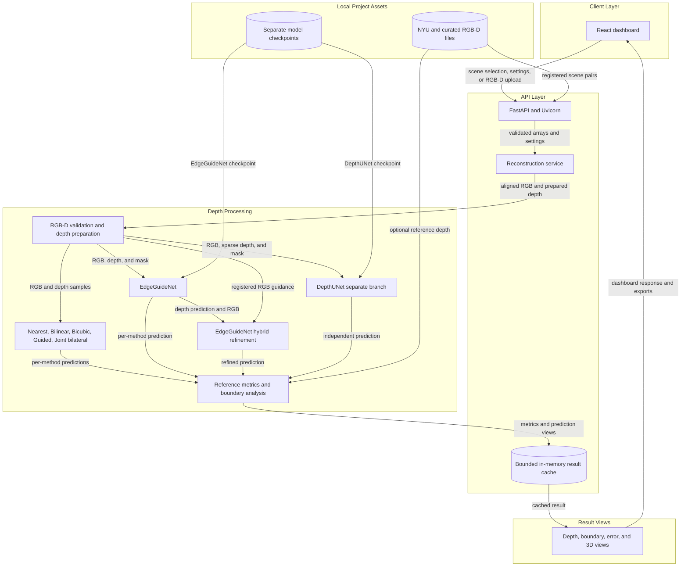
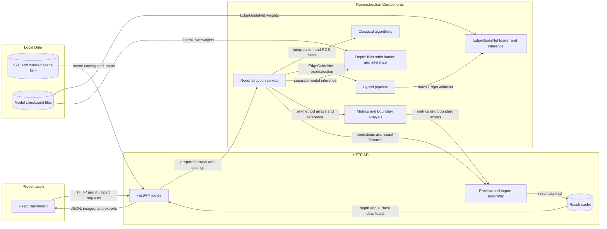

# Architecture Diagram

EdgeDepth accepts registered RGB and low-resolution or sparse depth, then compares
classical methods, EdgeGuideNet, a separate DepthUNet branch, and EdgeGuideNet hybrid
refinement. The editable flowchart and high-resolution export are maintained at the
repository root as `architecture_diagram.drawio` and `architecture_diagram.png`.

## Application Architecture

<!-- mermaid-checked: no \n, no em-dash/en-dash, no {} in labels, subgraphs are id["label"], arrows are -->|"label"|, all subgraphs closed by end, ids unique -->

### Technology Stack Summary

| Layer | Technology | Version | Purpose |
|---|---|---|---|
| Presentation | React | 18.3.1 | Interactive dashboard and result inspection |
| Frontend tooling | Vite | 6.x | Development server and production bundle |
| API | FastAPI and Uvicorn | FastAPI 0.110+; Uvicorn 0.29+ | Upload, scene, reconstruction, and export endpoints |
| Model runtime | PyTorch | 2.6+ | EdgeGuideNet and strictly loaded DepthUNet inference |
| Image and array processing | NumPy, OpenCV, Pillow | See `requirements.txt` | Depth processing, image decoding, and metrics |
| Visualization | Plotly | See `requirements.txt` | Metric charts and interactive 3D depth surfaces |

### Data Storage & External Services

There is no database, message broker, or required external service. Scenes and model
checkpoints are read from local project files. Reconstruction results are held in a
bounded in-memory cache for API downloads and visualization; they expire or are evicted
when capacity is reached.

### Key Architectural Decisions

- Classical baselines, EdgeGuideNet, and DepthUNet produce separate method predictions;
  DepthUNet does not replace EdgeGuideNet.
- Hybrid refinement consumes the EdgeGuideNet prediction and RGB guidance, then applies
  the configured Guided or Joint Bilateral filter and optional boundary sharpening.
- Quantitative metrics and absolute-error maps are only produced when reference depth is
  available; per-method depth, boundary, and 3D outputs do not require a reference.

## Component Relationships

<!-- mermaid-checked: no \n, no em-dash/en-dash, no {} in labels, subgraphs are id["label"], arrows are -->|"label"|, all subgraphs closed by end, ids unique -->

### Component Inventory

| Component | Layer | Type | Responsibility |
|---|---|---|---|
| React dashboard | Presentation | Frontend application | Scene selection, upload, experiment controls, comparisons, charts, and 3D view |
| FastAPI routes | HTTP API | REST and multipart endpoints | Health, scene catalog, reconstruction, cached depth export, and surface data |
| Preview and export assembly | HTTP API | Response transformation | Builds depth, boundary, error previews and JSON-safe metric payloads |
| Result cache | HTTP API | Bounded in-memory storage | Retains recent results for depth and surface requests |
| Reconstruction service | Processing | Orchestration service | Prepares data and runs selected reconstruction and evaluation paths |
| Classical algorithms | Processing | Baselines and filters | Nearest, Bilinear, Bicubic, Guided, and Joint Bilateral predictions |
| Hybrid pipeline | Processing | Refinement pipeline | Runs EdgeGuideNet, RGB-depth affinity, filtering, and optional sharpening |
| EdgeGuideNet loader and inference | Processing | Model runtime | Loads the EdgeGuideNet checkpoint and produces depth and boundary confidence |
| DepthUNet strict loader and inference | Processing | Separate model runtime | Loads the supplied five-channel checkpoint with strict state matching |
| Metrics and boundary analysis | Processing | Evaluation utilities | Computes valid-reference metrics and boundary scores |
| NYU and curated scene files | Data | Local image and depth files | Provides paired registered examples and optional references |
| Model checkpoint files | Data | Local model weights | Stores distinct EdgeGuideNet and DepthUNet checkpoints |
