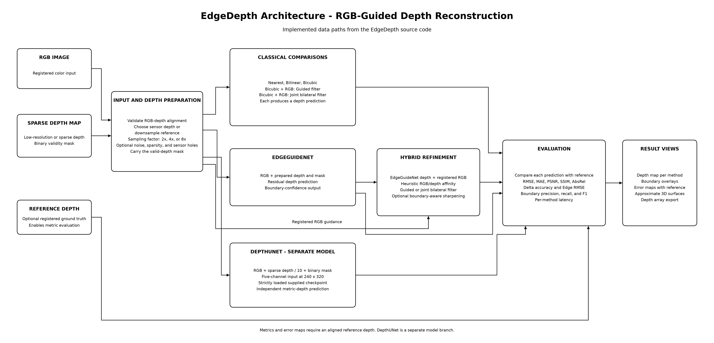
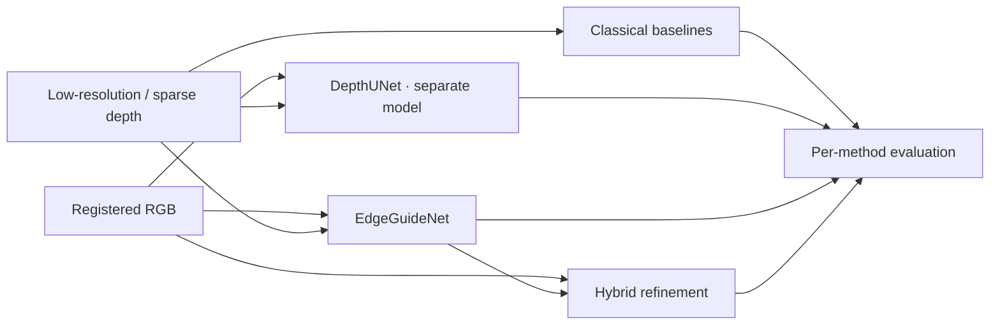

# EdgeDepth: Edge-Preserving Depth Map Upsampling and Refinement
### Problem Statement 4 (ProbID - P4) | Team 01

[](https://www.python.org/downloads/)
[](https://pytorch.org/)
[](https://streamlit.io/)
[](https://opensource.org/licenses/MIT)

---

## 📌 Executive Summary

**EdgeDepth** is an experimental RGB-guided depth reconstruction project. It compares interpolation, classical filtering, a residual CNN, and a hybrid refinement pipeline on low-resolution or sparse depth inputs.

Interpolation can blur depth discontinuities, while RGB-guided filters can copy image texture into depth. EdgeDepth exposes these trade-offs and evaluates them against reference depth rather than assuming that any method is always best.

### Key System Highlights:
1. **Multi-scale evaluation:** Compare 2x, 4x, and 8x reconstruction.
2. **RGB-guided refinement:** Inspect heuristic affinity gating; it reduces some texture transfer but is not a guarantee.
3. **EdgeGuideNet:** Residual CNN with RGB/depth feature gating and depth-gradient supervision.
4. **DepthUNet:** Separate Kaggle-trained five-channel model, loaded strictly from its supplied checkpoint.
5. **Sensor simulation:** Add noise, sparse sampling, and dropout holes to a reference depth map.
6. **Evaluation workspace:** Compare outputs, valid-pixel metrics, boundaries, error maps, and approximate 3D point clouds.

---

## 🏗️ System Architecture



[Editable Draw.io source](architecture_diagram.drawio)



### DepthUNet checkpoint integration

The supplied checkpoint is available at `models/best_depth_model.pth` (copied byte-for-byte
from the provided artifact; SHA-256
`EC427AAD7261C1F176E73775E192E44CA4F52BBB73751B9EB6ED41337FD92848`). It is a separate
model choice from EdgeGuideNet. Its checkpoint state dictionary uses a `module.` prefix
from `DataParallel`, `enc*.block.*`/`dec*.block.*` sequential-layer names, and bias-free
3×3 convolutions followed by batch normalization. The loader preserves the DataParallel
wrapper and requires `strict=True`; it never falls back to partially loaded or random
weights.

The original notebook attachment contained only the setup/configuration section, not the
full model class. Therefore `src/models/depth_unet.py` reconstructs the model structure
from the checkpoint keys and tensor shapes; it is not represented as the original
EdgeGuideNet architecture. Input preprocessing builds five channels in order: RGB in
`[0,1]`, sparse depth in metres divided by 10, and a binary validity mask. Inputs are
resized to 240×320, and the model output is in metres. The app maps sensor samples to the
selected 2×, 4×, or 8× grid and resizes predictions back to the RGB dimensions.

Set `DEPTHUNET_CHECKPOINT` to use a checkpoint at another path. The required safe
checkpoint loading uses PyTorch 2.6 or newer.

The supplied Kaggle performance report is shown here verbatim; these values were not
recomputed by the local inference check:

| Factor | MAE (m) | RMSE (m) | PSNR (dB) | SSIM | Edge MAE | Latency (ms/image) | Peak GPU memory (MB) |
|---|---:|---:|---:|---:|---:|---:|---:|
| 2× | 2.516442663288019 | 2.8686510331755875 | 10.846445565163938 | 0.19959219061297517 | 0.029757624 | 208.46976036030514 | 4685.46728515625 |
| 4× | 2.4585498109092283 | 2.8336643039547162 | 10.953031982490856 | 0.25361531027756307 | 0.029107228 | 218.60221849523123 | 4686.23291015625 |
| 8× | 2.5248062006243623 | 2.87688762492474 | 10.82154200783223 | 0.19358398042946356 | 0.028505104 | 219.34115698414166 | 4686.23291015625 |

**Important:** these test RMSE values (about 2.83–2.88 m) differ substantially from the
training history and diagnostics validation RMSE (about 0.0133 m). The diagnostics
explicitly flag this discrepancy. Do not treat the validation result as a test result or
combine these figures; compare only after verifying the checkpoint, data split, depth
units, preprocessing, and evaluation protocol.

For the architectural diagram and evaluation notes, please refer to:
- [`architecture_diagram.drawio`](architecture_diagram.drawio)
- [`ABLATION_AND_FAILURE_ANALYSIS.md`](ABLATION_AND_FAILURE_ANALYSIS.md)
- [`eval_P4_T79.md`](eval_P4_T79.md)

---

## 📋 Mandatory Technical Requirements Coverage

| Requirement Category | Implemented Components | File Reference |
|---|---|---|
| **A. Classical Computer Vision** | • Nearest, Bilinear, Bicubic Baselines<br>• Joint Bilateral Filter (Vectorized JBF)<br>• Guided Image Filter (He et al., Gray & Color)<br>• Boundary-Aware Refinement & Sharpening<br>• Discontinuity & Normal Variation Detection<br>• Denoising & PDE Hole Filling | [`src/classical/interpolation.py`](src/classical/interpolation.py)<br>[`src/classical/joint_bilateral.py`](src/classical/joint_bilateral.py)<br>[`src/classical/guided_filter.py`](src/classical/guided_filter.py)<br>[`src/classical/edge_refinement.py`](src/classical/edge_refinement.py)<br>[`src/classical/discontinuity.py`](src/classical/discontinuity.py)<br>[`src/classical/hole_filling.py`](src/classical/hole_filling.py) |
| **B. Deep Learning** | • EdgeGuideNet (Multi-scale Guided SR CNN)<br>• Separate checkpoint-derived DepthUNet (five-channel input)<br>• Edge Guidance Modules (Cross-Attention EGM)<br>• DepthGradientLoss & Charbonnier Loss<br>• Self-contained training & inference | [`src/models/guided_depth_net.py`](src/models/guided_depth_net.py)<br>[`src/models/depth_unet.py`](src/models/depth_unet.py)<br>[`src/models/losses.py`](src/models/losses.py)<br>[`src/models/weights_loader.py`](src/models/weights_loader.py)<br>[`train.py`](train.py) |
| **C. Hybrid Reconstruction** | • Deep structural prior + Classical filtering<br>• Anti-Texture-Copying Affinity Gating<br>• Sub-pixel boundary snapping<br>• Noise & hole robustness | [`src/hybrid/hybrid_pipeline.py`](src/hybrid/hybrid_pipeline.py) |
| **D. Evaluation & Profiling** | • RMSE, MAE, AbsRel, δ thresholds, PSNR, SSIM<br>• Edge-RMSE, gradient MAE, boundary precision/recall/F1<br>• Repeated median latency; Python-traced allocation (not process RSS) | [`src/metrics/evaluator.py`](src/metrics/evaluator.py)<br>[`run_benchmark.py`](run_benchmark.py) |

---

## 🚀 Quickstart & One-Command Run

### Option 1: Native Run (Local Environment)

1. **Clone the repository:**
   ```powershell
   git clone https://github.com/JAGADISH-JSK/Edgedepth-Depth-Reconstruction.git
   cd Edgedepth-Depth-Reconstruction
   ```

2. **Install dependencies:**
   ```powershell
   pip install -r requirements.txt
   ```

3. **Start the Streamlit dashboard:**
   ```powershell
   python -m streamlit run app.py
   ```
   Open the local URL printed by Streamlit (normally `http://localhost:8501`).

4. **Train EdgeGuideNet from scratch (PowerShell):**
   ```powershell
   python train.py --epochs 10 --batch-size 8 --patch-size 64 --from-scratch --checkpoint models\edge_guide_net_nyu_v2.pt
   ```
   By default, every training epoch visits each paired scene in the official NYU
   training split once. Twenty-four separate scenes from that split are held out for
   checkpoint selection; the official NYU validation split is never used for training.
   Smaller runs are available with `--samples-per-epoch N`.

5. **Evaluate that exact trained checkpoint:**
   ```powershell
   python run_benchmark.py --checkpoint models\edge_guide_net_nyu_v2.pt --max-scenes 8 --repeats 1 --output-md eval_nyu_trained.md --output-csv eval_nyu_trained.csv
   ```
   The report compares all methods on the same scenes at 2x/4x/8x and saves per-scene
   rows. Increase `--max-scenes` and `--repeats` for a longer evaluation.

6. **Run the dashboard with the available EdgeGuideNet checkpoint:**
   ```powershell
   Remove-Item Env:EDGEDEPTH_CHECKPOINT -ErrorAction SilentlyContinue
   python -m streamlit run app.py
   ```
   The project uses `models\edge_guide_net.pt` by default, resolved relative to the project
   files. Only set `EDGEDEPTH_CHECKPOINT` after training or copying a different EdgeGuideNet
   checkpoint into an existing path; relative overrides are also resolved from the project root.

### Kaggle GPU workflow

The local archive at `data/nyu-depth-png.zip` is about 442 MB and already matches this
project's paired `images/` and `depth/` format. Upload that archive as a private Kaggle
Dataset, and upload the project code (`train.py`, `run_benchmark.py`, and `src/`) as
another Kaggle Dataset. Attach both as Notebook inputs and enable a GPU accelerator.
In a Kaggle Notebook cell, extract the data and train:

```bash
%%bash
unzip -q /kaggle/input/<your-nyu-dataset-slug>/nyu-depth-png.zip -d /kaggle/working/nyu
python /kaggle/input/<your-project-code-slug>/train.py \
  --dataset-root /kaggle/working/nyu/nyu-depth-png \
  --epochs 10 --batch-size 8 --patch-size 64 --from-scratch \
  --checkpoint /kaggle/working/edge_guide_net_nyu_v2.pt
```

Then evaluate and save the report in the notebook's downloadable output directory:

```bash
%%bash
python /kaggle/input/<your-project-code-slug>/run_benchmark.py \
  --dataset-root /kaggle/working/nyu/nyu-depth-png \
  --checkpoint /kaggle/working/edge_guide_net_nyu_v2.pt \
  --max-scenes 8 --repeats 1 \
  --output-md /kaggle/working/eval_nyu_trained.md \
  --output-csv /kaggle/working/eval_nyu_trained.csv
```

Use the Notebook's **Output** panel after saving a notebook version to download the
checkpoint and reports. Kaggle data inputs are read-only; save generated files under
`/kaggle/working`. Check the GPU memory available and lower `--batch-size` if needed.

An alternative public Kaggle upload is
[NYUv2: Official Split Dataset](https://www.kaggle.com/datasets/awsaf49/nyuv2-official-split-dataset)
(about 29 GB). Its published split, file organization, and depth encoding differ from this
project's prepared archive, so it is **not a drop-in replacement** for the commands above.
If you use it, first adapt/convert its paired RGB-depth files and verify depth units.

---

### Public deployment (Streamlit Community Cloud)

The application is a single Streamlit app. It can be deployed from this GitHub
repository using Streamlit Community Cloud: choose the repository and branch, set the
app file to `app.py`, and deploy. The application runs entirely as a Streamlit app.

The free hosting tier has limited CPU, memory, and storage. This app loads PyTorch and
two model checkpoints, so verify that the service has enough resources for inference.
Keep the checkpoints available in the repository or configure an appropriate external
artifact source before deployment. Do not select or enable a paid hosting plan unless
you decide to do so.

---

## Evaluation

The committed report is generated by `run_benchmark.py` on a reproducibly sampled subset
of the official NYU Depth V2 validation split. It records per-scene results, mean and
standard deviation, scale breakdowns, device, timing protocol, and explicit limitations.
Do not treat results from a small subset as a universal ranking; use the CSV to inspect
scene-level failures and run a larger subset before making performance claims.

The checked-in starting checkpoint has undocumented training provenance. The command
above creates `models/edge_guide_net_nyu_v2.pt` from scratch; epoch count, train/holdout
scene counts, seed, and best holdout RMSE are recorded in the checkpoint. Use the same
checkpoint path for the benchmark and app. Holdout RMSE is for model selection, not an
independent test result.

---

## 📁 Repository Structure

```
P4_CV_Hack/
│
├── src/
│   ├── classical/                  # Classical CV algorithms
│   │   ├── interpolation.py        # Nearest, Bilinear, Bicubic baselines
│   │   ├── joint_bilateral.py      # Vectorized Joint Bilateral Filter
│   │   ├── guided_filter.py        # Exact O(1) Monochrome & Color Guided Filter
│   │   ├── edge_refinement.py      # Anti-texture affinity & boundary sharpening
│   │   ├── discontinuity.py        # Depth gradient & surface normal analysis
│   │   └── hole_filling.py         # Noise removal & Fast Marching inpainting
│   │
│   ├── models/                     # Deep learning architectures
│   │   ├── guided_depth_net.py     # EdgeGuideNet architecture & EGMs
│   │   ├── depth_unet.py           # Checkpoint-derived, strictly loaded DepthUNet
│   │   ├── losses.py               # EdgePreservingLoss & DepthGradientLoss
│   │   └── weights_loader.py       # Checkpoint loader & inference wrapper
│   │
│   ├── hybrid/                     # Hybrid fusion pipeline
│   │   └── hybrid_pipeline.py      # End-to-end multi-stage reconstructor
│   │
│   ├── metrics/                    # Quantitative evaluation suite
│   │   └── evaluator.py            # RMSE, MAE, PSNR, SSIM, Edge-RMSE, F1, latency
│   │
│   └── utils/                      # Datasets & visualizer utilities
│       ├── dataset.py              # I/O for NYUv2, Middlebury, KITTI
│       ├── degradations.py         # Downsampling, noise & LiDAR sparsity
│       ├── visualization.py        # Colormaps, error heatmaps & Plotly 3D
│       └── generate_samples.py     # Preset dataset generator
│
├── data/
│   ├── nyu_depth_v2/               # Official NYU Depth V2 (795 train + 654 validation)
│   │   └── nyu-depth-png/
│   │       ├── images/ (train: 795, val: 654)
│   │       └── depth/  (train: 795, val: 654)
│   └── samples/                    # Quick-access curated benchmark pairs (NYUv2, Middlebury, KITTI)
├── models/edge_guide_net.pt        # Bundled EdgeGuideNet checkpoint used by default
├── models/best_depth_model.pth    # Supplied Kaggle DepthUNet checkpoint (unchanged)
├── app.py                          # Streamlit dashboard
├── src/services/reconstruction.py  # UI-independent reconstruction service
├── run_benchmark.py                # Automated evaluation script
├── train.py                        # Self-contained training script
├── architecture_diagram.png        # High-res architecture diagram
├── ABLATION_AND_FAILURE_ANALYSIS.md# Ablation experiments & failure cases
├── architecture_diagram.drawio     # Editable architecture diagram
├── requirements.txt                # Python dependencies
└── README.md                       # Main documentation
```

---

## 🎤 3-Minute Demo & Viva Cheat Sheet

1. **Introduction (30s):** Show the problem in the EdgeDepth dashboard. Select Bicubic at 8× and point out the blurry intermediate ramp between foreground and background.
2. **Classical vs Texture-Copying (45s):** Open Boundary analysis and compare the guided result with the input RGB edges to discuss texture transfer.
3. **Hybrid Refinement (45s):** Enable anti-texture suppression and adjust boundary refinement. Compare the hybrid prediction and affinity visualization without assuming a guaranteed improvement.
4. **3D & Evaluation (40s):** Rotate the interactive depth surface under 3D inspection, then compare metrics under Evaluation. Interpret results against the displayed reference and avoid claiming a universal best method.
5. **Failure Case (20s):** Explain transparent glass or specular mirrors, where RGB cues contradict physical distance, and show our fallback inpainting mechanism.

---